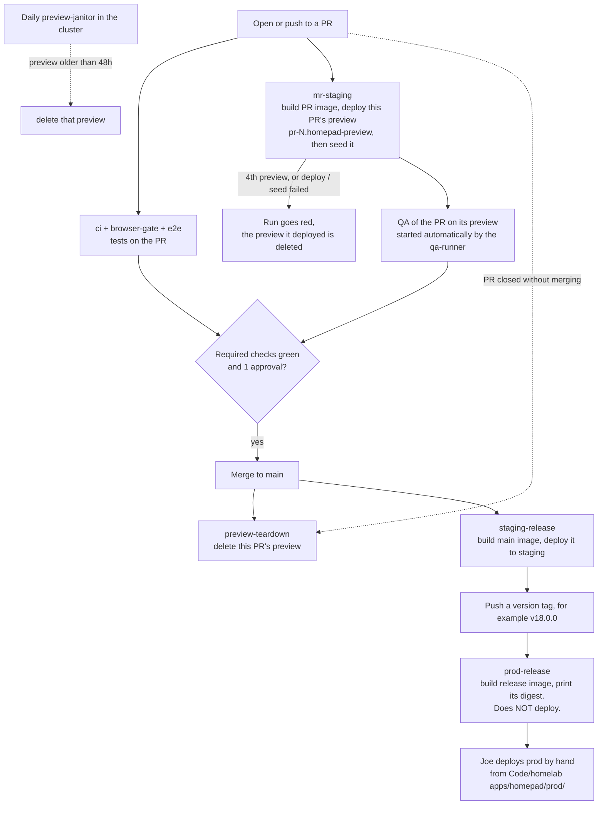

# What the Gitea Actions workflows in this repo do

This page explains every workflow in this folder in plain English, so you don't
have to read the YAML. Gitea only runs the `.yml` files here; it ignores this
README.

A few words used below:

- **Workflow**: one `.yml` file. Gitea runs it automatically when its trigger happens.
- **PR**: a pull request into `main`.
- **Image**: the packaged app (a container) that the cluster runs. Images live in
  the homelab container registry. Each image has one or more **tags** (labels such
  as `abc1234-test`).
- **Staging**: the test copy of homepad on the homelab staging cluster, in the
  `homepad-staging` namespace (a namespace is a named folder inside the cluster).
  It runs whatever is on `main`. PRs no longer deploy there.
- **Preview**: a short-lived copy of homepad for **one PR**: its own web, API and
  empty database, in the `homepad-preview` namespace, at
  `http://pr-<number>.homepad-preview.<cluster-domain>` (the real
  domain is in `docs/environments.local.md`, gitignored). At most **3** previews
  can run at once. Each PR's QA runs against its own preview
  (`specs/SPEC-preview-environments.md`).
- **Prod**: the real homepad everyone uses.
- **Required check**: a check that must be green before Gitea lets a PR merge.
- **ci-shared**: a shared repo (`Code/ci-shared`) holding reusable steps. Three of
  these workflows hand most of their work to it.

## The big picture

The janitor is not a workflow in this repo. It is a CronJob in `homepad-preview`
(Code/homelab `apps/homepad/preview/05-cleanup.yaml`) that catches a preview
whose teardown never ran.

## At a glance

| Workflow | Runs when | Deploys to | Blocks merge? |
|---|---|---|---|
| `ci.yml` (CI) | A PR is opened or updated | Nothing | **Yes**: two required checks, Web and API |
| `browser-gate.yml` (Browser gate) | A PR is opened or updated | Nothing | **Yes**: required check |
| `e2e.yml` (E2E) | A PR is opened or updated | Nothing | No: reports only, not required yet |
| `mr-staging.yml` (PR -> staging gate) | A PR into `main` is opened or updated | `homepad-preview`: this PR's own preview | Not by itself. The merge needs an approval, and that approval normally comes from the QA this workflow is meant to start |
| `preview-teardown.yml` (Preview teardown) | A PR into `main` is closed or merged | Deletes this PR's preview | No: runs after the PR is closed |
| `staging-release.yml` (main -> staging build) | Every push to `main` (every merge) | `homepad-staging` | No: runs after the merge |
| `prod-release.yml` (Prod release) | A tag starting with `v` is pushed, or someone starts it by hand | **Nothing.** Prod is deployed by Joe | No: runs after the release |

To merge a PR into `main`, Gitea requires: both CI checks (Web, API) green, the Browser gate
check green, and one approval from an allowed approver (the QA bot or the
docs-only approver bot). Approvals are dropped when new commits are pushed.

---

## `ci.yml`: CI

**When it runs:** every time a PR is opened or gets new commits. It does not run
on pushes to `main` or to branches without a PR.

**What it does:** two jobs, and both always report (SPEC-monorepo-api AC-004).
Each first asks `scripts/ci/changed-sides.sh` which side the PR changed: `api/`
is the API; `.gitea/`, `.github/`, `scripts/ci/` and `compose.yaml` are both;
everything else is the web. A job whose side didn't change passes straight away
with "skipped: no web changes" or "skipped: no API changes".

- **Web (build, unit tests):** the preview and CI script tests
  (`scripts/preview/*.test.sh`, `scripts/ci/*.test.sh`), then installs the app's
  packages from the lockfile (`npm ci`), runs the linter (`npm run lint`; errors
  fail the check, warnings don't), builds the app (`npm run build`, which also
  type-checks it) and runs the unit tests (`vitest`).
- **API (vet, build, tests):** `go vet`, `go build` and
  `go test ./... -count=1 -p 1` from `api/`, against a Postgres 17 service.

**What it changes outside the repo:** nothing. It only posts its green/red
check on the PR.

**What it does NOT do:** it doesn't build an image or deploy anything. It is
not re-run after the merge. `main` is protected, so the commit that merges is
the commit that was tested.

**If it fails:** a lint error, a type error, a build error, a failing unit
test, or a failing Go test. Open the run's log and find the first red step. Fix it on the PR branch.

---

## `browser-gate.yml`: Browser gate

**When it runs:** every time a PR is opened or gets new commits.

**What it does:**

- Looks at which files the PR changed.
- If nothing touches tiles, menus, drag-and-drop, the gate's own tests, or
  `package.json`, it passes right away without testing anything.
- Otherwise it installs packages, builds the app, and runs a small set of
  tests in a real Chromium browser (`npm run test:gate`).
- It runs inside a Playwright container image that already has the browser, so
  nothing is downloaded during the run.

**What it changes outside the repo:** nothing. It only posts its check on the PR.

**What it does NOT do:** skipping the browser tests still reports a green
check. That is on purpose. A required check that never reports would block the
PR forever.

**If it fails:** a real-browser click or drag on tiles/menus didn't behave. Unit
tests can't catch this kind of bug, which is why this gate exists. If it fails in
the "Verify preinstalled Chromium" step instead, the Playwright version in
`package-lock.json` no longer matches the container image tag in the workflow.
Update the image tag to match.

---

## `e2e.yml`: E2E

**When it runs:** every time a PR is opened or gets new commits.

**What it does:**

- Installs packages and builds the app.
- Serves the built app locally inside the run.
- Runs the end-to-end tests (`npm run test:e2e`) in Chromium and WebKit (a phone
  profile). The tests fake the API, so no backend or database is needed.
- If it fails, it uploads the browser traces as a run artifact (kept 7 days).

A PR that changes only the API skips it, green ("skipped: no web changes").

**What it changes outside the repo:** nothing besides the check and, on
failure, the trace artifact.

**What it does NOT do:** it is **not** a required check yet, so a red E2E run
does not block the merge on its own. Look at it anyway.

**If it fails:** download the `playwright-traces` artifact from the run and open
it to see what the page looked like. The suite also scans the built app for
leaked secrets, so a failure can mean something sensitive ended up in the bundle.

---

## `mr-staging.yml`: PR -> staging gate

**When it runs:** every time a PR into `main` is opened or gets new commits.
Only one run per PR at a time: a new push cancels the PR's run that is still
going (`concurrency`, group `preview-pr-<number>`). Two pushes in the same second
once started two runs for PR #632, and one deleted the preview the other had just
deployed.

**What it does** (most steps come from ci-shared's `mr-staging`):

- If the PR only changes docs, it skips everything below. No build, no deploy,
  no QA. "Docs" means every changed file matches ci-shared's `DOCS_RE`
  (`mr-staging/action.yml`, v3): a `.md`, `.mdx` or `.txt` file; anything in a
  `docs/` or `specs/` folder, at any depth; anything in `one-pagers/` at the
  top; or a README, CHANGELOG or LICENSE file.
  It then auto-approves the PR as the `ci-docs-approver` bot, which clears the
  one-approval rule, so a docs-only PR needs no human approval. This workflow
  passes the bot's token (`DOCS_APPROVER_TOKEN`) into the step; without it the
  approve step only logs a warning.
- It does **not** re-run the unit tests. CI and Browser gate already test this
  exact commit.
- Builds the PR's image and pushes it with two tags: `<short-sha>-test` and
  `<short-sha>`. ("short-sha" is the first 7 characters of the commit id.)
- Deploys it to **this PR's preview** in `homepad-preview`:
  - Downloads the four preview templates from Code/homelab
    `apps/homepad/preview/template/` (database, API, web + nginx settings, and the
    web address).
  - Picks the API image (`scripts/preview/api-image.sh`): if the PR changed
    `api/`, it builds and pushes `homepad-api:<short-sha>-test` (and
    `:<short-sha>`) from `api/`; otherwise it uses the API image that staging
    runs. The web image is built on every PR, because QA checks the preview's
    `/version.json` against the PR's commit.
  - Fills in the PR number, commit, images, the time of this deploy and this
    run's id (`homepad.preview/run`, run id and attempt)
    (`scripts/preview/render.sh`).
  - Applies them, then waits up to 2 minutes each for the database, the API and
    the web app to come up.
  - Runs the QA seed (`scripts/seed-qa.sh`, #623) against the preview. It creates
    the QA admin from the `QA_EMAIL` / `QA_PASSWORD` secrets and a fixed set of
    sample data. It runs on every push; a second run changes nothing.
  - The first push creates the preview. Later pushes update the web app in place
    and keep the database.
  - If the apply, rollout or seed fails, it **deletes this PR's preview** before
    going red, so a broken preview doesn't keep one of the 3 slots. It deletes
    only a preview this run deployed: if the web app carries another run's id,
    a newer deploy owns the preview, so it is kept and the run logs "a newer
    deploy owns pr-<number>; not tearing down" (`scripts/preview/teardown-if-owner.sh`).
- Then it starts QA of the PR on its preview. Who does the QA depends on the repo
  variable `QA_BACKEND` (see below). For homepad that's `docker-claude`: the
  qa-runner QAs every PR automatically, nobody has to start it.

**What it changes outside the repo:**

- **Registry:** pushes `homepad:<short-sha>-test` and `homepad:<short-sha>`.
- **Preview:** creates or updates this PR's objects in `homepad-preview`, all
  labelled `pr=<number>`: three deployments (web, API, database), their services,
  the nginx ConfigMap (a settings file the cluster stores) and the web address.
  Other PRs' previews and `homepad-staging` are not touched. The nginx config
  comes from the Code/homelab template, **not** from the image, so changing
  `nginx.conf` in this repo does not change what the preview serves.
- **QA**, picked by the `QA_BACKEND` repo variable:
  - `nats` (the default if the variable is unset): sends a task to the QA bot
    pool. On a pass the QA bot approves and merges the PR; on a fail it asks for
    changes.
  - `docker-claude` (what homepad uses): starts a one-off qa-runner job on the
    cluster that tests the PR's preview, checks that the preview is really
    running this PR's commit, and approves and squash-merges on a pass. It logs
    in through `http://pr-<number>.homepad-preview.<cluster-domain>/api/login`
    (the `qa-login-url` input) with the test login the qa-runner holds, the same
    one the seed created. The model is
    Sonnet 5.5 at medium effort, set on the qa-runner trigger, not here.
  - Any other value: no QA is started. The run logs an error note but still
    goes green, and someone has to start QA by hand.
  - Either way, QA is only started for the PR's newest commit. Older pushes are
    skipped.

**What it does NOT do:** this check is not itself required. A green mr-staging
run does not mean the PR was QA'd; it means the image was built and deployed.
The merge still needs an approval.

**If it fails:** usually the image build (the Dockerfile or `npm run build`
inside it), or the preview deploy. The deploy step's error note names the step
that failed:

- `apply` with "3 previews already running; merge or close one": three other PRs
  already have previews. Merge or close one of them, then re-run this job. Nothing
  is evicted automatically.
- `fetch`: a template couldn't be downloaded from Code/homelab.
- `api-image`: the PR's API image didn't build, or main's couldn't be read.
- `rollout`: the database, API or web app didn't become ready within 2 minutes.
- `seed`: the QA seed failed, so QA would have run against an empty install.

After an `apply`, `rollout` or `seed` failure, the preview this run deployed has
already been deleted; a re-run starts from scratch. A `fetch` failure deployed
nothing, so it deletes nothing: an earlier push's preview stays up. A QA dispatch problem never turns the run red; look for an error note in
the "Dispatch QA" step instead.

---

## `preview-teardown.yml`: Preview teardown

**When it runs:** when a PR into `main` is closed, merged or not.

**What it does:** deletes every deployment, service, ConfigMap and web address
labelled `pr=<number>` in `homepad-preview`, which is this PR's whole preview.

**What it changes outside the repo:** frees one of the 3 preview slots.

**What it does NOT do:** nothing else. If the PR never had a preview (a docs-only
PR, say), it finds nothing and still goes green.

**If it fails:** the preview stays up until the daily janitor deletes it, at the
latest 48 hours after its last deploy. Re-run the job to free the slot sooner.

---

## `staging-release.yml`: main -> staging build

**When it runs:** every push to `main`, which in practice means every merged PR.

**What it does** (from ci-shared's `staging-release`), in two jobs, API first.
Every merge builds both images, whichever side changed, so every `main` commit
has a matching pair:

- **API:** builds `homepad-api` from `api/`, applies the API Deployment from
  Code/homelab `apps/homepad/staging/02-api.yaml` with the new image, and waits
  up to 2 minutes (`scripts/ci/staging-api-rollout.sh`). It fails the run if the
  API isn't ready or its boot log has no `migrations applied` line.
- **Web** (`needs: api`, so it never rolls onto a broken API): builds the web
  image, applies the nginx config from Code/homelab, points `homepad-web` at the
  new image, restarts it, and waits up to 2 minutes.
- Each image is pushed with two tags: `<short-sha>-beta` and `<short-sha>`.
- No tests and no QA. The PR was already tested and approved before it merged.

**What it changes outside the repo:**

- **Registry:** pushes `homepad:` and `homepad-api:` `<short-sha>-beta` and `<short-sha>`.
- **Staging:** `homepad-staging` now runs `main`. PR previews in
  `homepad-preview` are not touched, so a merge never interrupts another PR's QA.
- **ConfigMap:** re-applies the `homepad-web` nginx config from Code/homelab
  `apps/homepad/staging/03-web.yaml`.

**What it does NOT do:** it doesn't touch prod.

**If it fails:** an image build broke on `main`, or a staging deploy failed (manifest
fetch from Code/homelab, a pod not becoming ready, or no `migrations applied` in
the API's boot log). If the API job fails, the web job doesn't run. `main` is fine, but
staging may still be running the previous build.

---

## `prod-release.yml`: Prod release (vX.Y.Z tag)

**When it runs:** when a tag starting with `v` is pushed (for example `v18.0.0`).
It can also be started by hand. That's a fallback for when Gitea misses the tag
push. Start it on the full tag ref `refs/tags/vX.Y.Z`, not just `vX.Y.Z`.

**What it does** (from ci-shared's `prod`, pinned to one exact commit):

- Checks that the tag, the top entry of `CHANGELOG.md`, and the `version` in
  `package.json` all say the same version. If they don't, it stops before
  building anything.
- Builds the release image with the version baked in (so the app footer shows
  it) and pushes three tags: `X.Y.Z`, `X.Y.Z-<short-sha>` and `latest`.
- Looks up the image's digest (its permanent fingerprint) and prints it in the
  log, ready to paste into Code/homelab.
- Sends a "release published" notice to Joe.
- Creates the Gitea release page for the tag, using that version's CHANGELOG
  section as the text.

**What it changes outside the repo:**

- **Registry:** pushes `homepad:X.Y.Z`, `homepad:X.Y.Z-<short-sha>` and moves
  `homepad:latest`.
- **Gitea:** creates the release for the tag.
- **Notification:** a release notice to Joe. Skipped quietly if not set up.

**What it does NOT do:** it does **not** deploy prod. That's on purpose, not
an unfinished step. Prod's image pins live in Code/homelab
`apps/homepad/prod/`, and **Joe deploys prod by hand** from there, using the
digest this run prints. It also doesn't regenerate `src/changelog.json`; that file
is edited by hand in the release PR.

**If it fails:** most often the version check: the tag, `CHANGELOG.md` and
`package.json` disagree. Fix the files, then re-tag. Next most common is the image
build. If only the digest lookup fails, the run stays green and prints the
`X.Y.Z-<short-sha>` tag to pin instead. If only the release page fails, the run
stays green too; create the release by hand. If no run appeared at all after
pushing the tag, start it by hand on `refs/tags/vX.Y.Z`.
