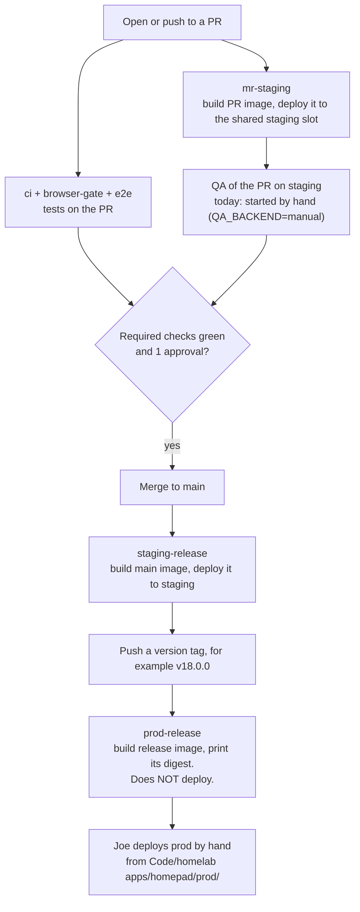

# What the Gitea Actions workflows in this repo do

This page explains every workflow in this folder in plain English, so you don't
have to read the YAML. Gitea only runs the `.yml` files here; it ignores this
README.

A few words used below:

- **Workflow**: one `.yml` file. Gitea runs it automatically when its trigger happens.
- **PR**: a pull request into `main`.
- **Image**: the packaged app (a container) that the cluster runs. Images live in
  the homelab container registry. Each image has one or more **tags** (labels such
  as `abc1234-test`).
- **Staging**: the test copy of homepad on the homelab staging cluster, in the
  `homepad-staging` namespace (a namespace is a named folder inside the cluster).
  There is only **one** staging slot. Whatever was deployed last is what's there.
- **Prod**: the real homepad everyone uses.
- **Required check**: a check that must be green before Gitea lets a PR merge.
- **ci-shared**: a shared repo (`Code/ci-shared`) holding reusable steps. Three of
  these workflows hand most of their work to it.

## The big picture

## At a glance

| Workflow | Runs when | Deploys to | Blocks merge? |
|---|---|---|---|
| `ci.yml` (CI) | A PR is opened or updated | Nothing | **Yes**: required check |
| `browser-gate.yml` (Browser gate) | A PR is opened or updated | Nothing | **Yes**: required check |
| `e2e.yml` (E2E) | A PR is opened or updated | Nothing | No: reports only, not required yet |
| `mr-staging.yml` (PR -> staging gate) | A PR into `main` is opened or updated | `homepad-staging` (the one shared slot) | Not by itself. The merge needs an approval, and that approval normally comes from the QA this workflow is meant to start |
| `staging-release.yml` (main -> staging build) | Every push to `main` (every merge) | `homepad-staging` | No: runs after the merge |
| `prod-release.yml` (Prod release) | A tag starting with `v` is pushed, or someone starts it by hand | **Nothing.** Prod is deployed by Joe | No: runs after the release |

To merge a PR into `main`, Gitea requires: the CI check green, the Browser gate
check green, and one approval from an allowed approver (the QA bot or the
docs-only approver bot). Approvals are dropped when new commits are pushed.

---

## `ci.yml`: CI

**When it runs:** every time a PR is opened or gets new commits. It does not run
on pushes to `main` or to branches without a PR.

**What it does:**

- Installs the app's packages from the lockfile (`npm ci`).
- Runs the linter (`npm run lint`). Errors fail the check; warnings don't.
- Builds the app (`npm run build`), which also type-checks it.
- Runs the unit tests (`vitest`).

**What it changes outside the repo:** nothing. It only posts its green/red
check on the PR.

**What it does NOT do:** it doesn't build an image or deploy anything. It is
not re-run after the merge. `main` is protected, so the commit that merges is
the commit that was tested.

**If it fails:** a lint error, a type error, a build error, or a failing unit
test. Open the run's log and find the first red step. Fix it on the PR branch.

---

## `browser-gate.yml`: Browser gate

**When it runs:** every time a PR is opened or gets new commits.

**What it does:**

- Looks at which files the PR changed.
- If nothing touches tiles, menus, drag-and-drop, the gate's own tests, or
  `package.json`, it passes right away without testing anything.
- Otherwise it installs packages, builds the app, and runs a small set of
  tests in a real Chromium browser (`npm run test:gate`).
- It runs inside a Playwright container image that already has the browser, so
  nothing is downloaded during the run.

**What it changes outside the repo:** nothing. It only posts its check on the PR.

**What it does NOT do:** skipping the browser tests still reports a green
check. That is on purpose. A required check that never reports would block the
PR forever.

**If it fails:** a real-browser click or drag on tiles/menus didn't behave. Unit
tests can't catch this kind of bug, which is why this gate exists. If it fails in
the "Verify preinstalled Chromium" step instead, the Playwright version in
`package-lock.json` no longer matches the container image tag in the workflow.
Update the image tag to match.

---

## `e2e.yml`: E2E

**When it runs:** every time a PR is opened or gets new commits.

**What it does:**

- Installs packages and builds the app.
- Serves the built app locally inside the run.
- Runs the end-to-end tests (`npm run test:e2e`) in Chromium and WebKit (a phone
  profile). The tests fake the API, so no backend or database is needed.
- If it fails, it uploads the browser traces as a run artifact (kept 7 days).

**What it changes outside the repo:** nothing besides the check and, on
failure, the trace artifact.

**What it does NOT do:** it is **not** a required check yet, so a red E2E run
does not block the merge on its own. Look at it anyway.

**If it fails:** download the `playwright-traces` artifact from the run and open
it to see what the page looked like. The suite also scans the built app for
leaked secrets, so a failure can mean something sensitive ended up in the bundle.

---

## `mr-staging.yml`: PR -> staging gate

**When it runs:** every time a PR into `main` is opened or gets new commits.

**What it does** (most steps come from ci-shared's `mr-staging`):

- If the PR only changes docs (Markdown, text, `docs/`, `specs/`, README,
  CHANGELOG, LICENSE), it skips everything below. No build, no deploy, no QA.
  It then tries to auto-approve the PR as the `ci-docs-approver` bot, but today
  that **doesn't work**: this workflow doesn't pass the approver's token, so the
  run only logs a warning (and stays green). A docs-only PR still needs someone
  to approve it.
- It does **not** re-run the unit tests. CI and Browser gate already test this
  exact commit.
- Builds the PR's image and pushes it with two tags: `<short-sha>-test` and
  `<short-sha>`. ("short-sha" is the first 7 characters of the commit id.)
- Deploys it to staging: applies the web nginx settings from Code/homelab, points
  the `homepad-web` deployment at the new image, restarts it, and waits up to
  2 minutes for it to come up.
- Then it tries to start QA of the PR on staging. Who does the QA depends on the
  repo variable `QA_BACKEND` (see below).

**What it changes outside the repo:**

- **Registry:** pushes `homepad:<short-sha>-test` and `homepad:<short-sha>`.
- **Staging:** replaces what's running in `homepad-staging` with this PR's build.
  There is **one** shared staging slot. Any push to any open PR replaces it. If
  two PRs are open, staging shows whichever one pushed last.
- **ConfigMap:** re-applies the `homepad-web` nginx config in `homepad-staging`
  (a ConfigMap is a settings file the cluster stores). The nginx config comes
  from Code/homelab `apps/homepad/staging/03-web.yaml`, **not** from the image.
  Changing `nginx.conf` in this repo does not change what staging serves.
- **QA**, picked by the `QA_BACKEND` repo variable:
  - `nats` (the default if the variable is unset): sends a task to the QA bot
    pool. On a pass the QA bot approves and merges the PR; on a fail it asks for
    changes.
  - `docker-claude`: starts a one-off QA job on the cluster that tests staging,
    checks that staging is really running this PR's commit, and approves and
    squash-merges on a pass.
  - **Any other value (today it's `manual`)**: no QA is started. The run logs an
    error note but still goes green. On this repo, QA is started by hand, because
    there is only one staging slot.
  - Either way, QA is only started for the PR's newest commit. Older pushes are
    skipped.

**What it does NOT do:** this check is not itself required. A green mr-staging
run does not mean the PR was QA'd; it means the image was built and deployed.
The merge still needs an approval.

**If it fails:** usually the image build (the Dockerfile or `npm run build`
inside it), or the staging deploy: the nginx manifest couldn't be fetched from
Code/homelab, or the new pod didn't become ready within 2 minutes (look at the
staging pod's logs). A QA dispatch problem never turns the run red; look for an
error note in the "Dispatch QA" step instead.

---

## `staging-release.yml`: main -> staging build

**When it runs:** every push to `main`, which in practice means every merged PR.

**What it does** (from ci-shared's `staging-release`):

- Builds the image from `main` and pushes it with two tags:
  `<short-sha>-beta` and `<short-sha>`.
- Deploys it to staging the same way mr-staging does: applies the nginx config
  from Code/homelab, points `homepad-web` at the new image, restarts it, and waits
  up to 2 minutes.
- No tests and no QA. The PR was already tested and approved before it merged.

**What it changes outside the repo:**

- **Registry:** pushes `homepad:<short-sha>-beta` and `homepad:<short-sha>`.
- **Staging:** `homepad-staging` now runs `main`. This replaces any PR build that
  was there.
- **ConfigMap:** re-applies the `homepad-web` nginx config from Code/homelab
  `apps/homepad/staging/03-web.yaml`.

**What it does NOT do:** it doesn't touch prod.

**If it fails:** the image build broke on `main`, or the staging deploy failed (manifest
fetch from Code/homelab, or the pod not becoming ready). `main` is fine, but
staging may still be running the previous build.

---

## `prod-release.yml`: Prod release (vX.Y.Z tag)

**When it runs:** when a tag starting with `v` is pushed (for example `v18.0.0`).
It can also be started by hand. That's a fallback for when Gitea misses the tag
push. Start it on the full tag ref `refs/tags/vX.Y.Z`, not just `vX.Y.Z`.

**What it does** (from ci-shared's `prod`, pinned to one exact commit):

- Checks that the tag, the top entry of `CHANGELOG.md`, and the `version` in
  `package.json` all say the same version. If they don't, it stops before
  building anything.
- Builds the release image with the version baked in (so the app footer shows
  it) and pushes three tags: `X.Y.Z`, `X.Y.Z-<short-sha>` and `latest`.
- Looks up the image's digest (its permanent fingerprint) and prints it in the
  log, ready to paste into Code/homelab.
- Sends a "release published" notice to Joe.
- Creates the Gitea release page for the tag, using that version's CHANGELOG
  section as the text.

**What it changes outside the repo:**

- **Registry:** pushes `homepad:X.Y.Z`, `homepad:X.Y.Z-<short-sha>` and moves
  `homepad:latest`.
- **Gitea:** creates the release for the tag.
- **Notification:** a release notice to Joe. Skipped quietly if not set up.

**What it does NOT do:** it does **not** deploy prod. That's on purpose, not
an unfinished step. Prod's image pins live in Code/homelab
`apps/homepad/prod/`, and **Joe deploys prod by hand** from there, using the
digest this run prints. It also doesn't regenerate `src/changelog.json`; that file
is edited by hand in the release PR.

**If it fails:** most often the version check: the tag, `CHANGELOG.md` and
`package.json` disagree. Fix the files, then re-tag. Next most common is the image
build. If only the digest lookup fails, the run stays green and prints the
`X.Y.Z-<short-sha>` tag to pin instead. If only the release page fails, the run
stays green too; create the release by hand. If no run appeared at all after
pushing the tag, start it by hand on `refs/tags/vX.Y.Z`.
