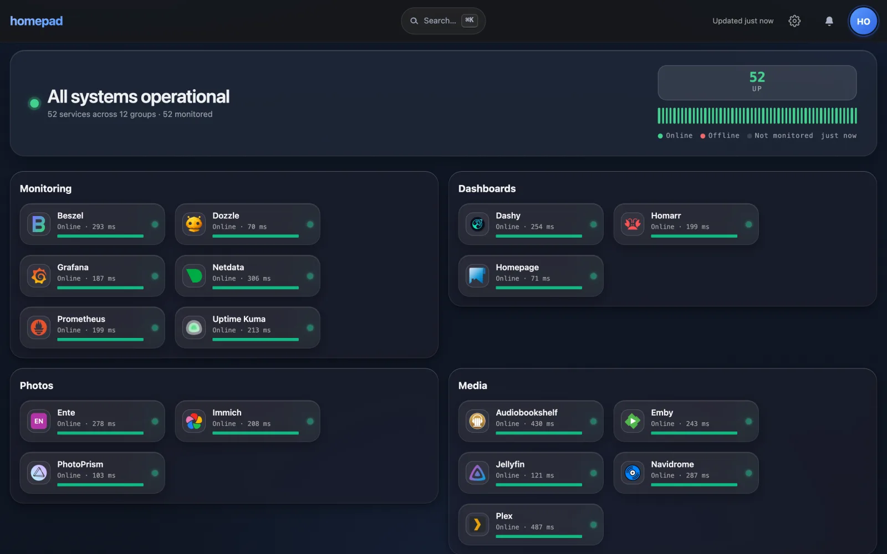
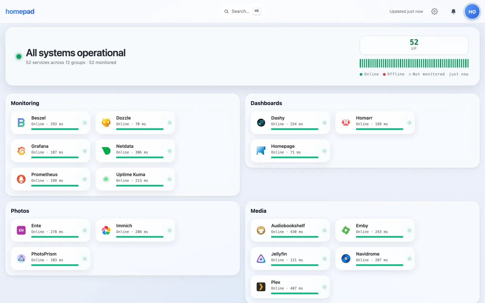
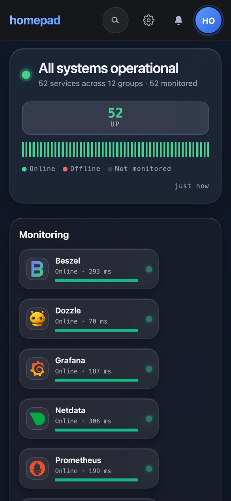

<p align="center">
  
</p>

<p align="center">
  <strong>The self-hosted homelab dashboard for the whole household.</strong><br>
  Every service in one place, with live health, and a personal view for everyone under your roof.
</p>

<p align="center">
  <a href="https://gethomepad.dev">Website</a> ·
  <a href="https://demo.gethomepad.dev">Live demo</a> ·
  <a href="#quickstart">Quickstart</a> ·
  <a href="#how-it-compares">Compare</a> ·
  <a href="./docs/development.md">Develop</a>
</p>

<p align="center">
  <a href="https://github.com/finish06/homepad/tags"></a>
  <a href="https://github.com/finish06/homepad/pkgs/container/homepad"></a>
  <a href="./LICENSE"></a>
  <a href="https://github.com/finish06/homepad/stargazers"></a>
</p>

<p align="center">
  
</p>

## Try it in 10 seconds

**[demo.gethomepad.dev](https://demo.gethomepad.dev)**, log in with `homepad@gethomepad.dev` / `homepad1`. There's no signup. The demo may take about 15 seconds to wake up.

## Quickstart

You need Docker with Compose v2.23 or newer. Nothing else to clone or build:

```bash
mkdir homepad && cd homepad
curl -fsSLO https://raw.githubusercontent.com/finish06/homepad/main/compose.yaml
echo "POSTGRES_PASSWORD=$(openssl rand -hex 16)" > .env
docker compose up -d
```

Open **http://localhost:8080** and register: **the first account becomes the admin.** Then set `HOMEPAD_REGISTRATION=invite_only` in `.env` and run `docker compose up -d` again, so only you can add accounts.

Next steps:
- **Add your apps.** Pick from the built-in App Library of 50+ self-hosted apps with icons, or add your own.
- **Live status.** Connect [Gatus](https://gatus.io): add `COMPOSE_PROFILES=gatus` and `GATUS_BASE_URL=http://gatus:8080` to `.env` to run one alongside. See [docs/monitoring.md](./docs/monitoring.md).
- **Kids.** Give a kid a dashboard with only the apps you choose, signed in on the family iPad for months. See [docs/kid-accounts.md](./docs/kid-accounts.md).
- **Single sign-on.** See [SSO](#single-sign-on) below.
- **Update** with `docker compose pull && docker compose up -d`.

Images: `ghcr.io/finish06/homepad` and `ghcr.io/finish06/homepad-api`, for linux/amd64 and linux/arm64 (so a Raspberry Pi works). They're pinned by `HOMEPAD_VERSION` in `.env`.

## Why Homepad

Most homelab dashboards are built for one admin staring at one config file. Homepad is built for **a household**: one shared catalog of services, and everyone gets their own view of it.

- **Per-person views.** Each person has their own favorites, tile order, theme and density, all over one shared catalog that the admin manages in the browser. No YAML. Each tile opens in a new tab, the same tab, or an embedded overlay.
- **Live health, without leaking your network.** Each tile shows UP / DEGRADED / DOWN and its response time, plus recent uptime. Health comes from [Gatus](https://gatus.io) and is resolved **server-side**: your internal hostnames and your Gatus URL never reach the browser.
- **Real login, built in.** Local accounts, or OIDC with PKCE and an admin group claim: PocketID, Authelia, Authentik, Keycloak and so on. No reverse-proxy auth bolt-on.
- **Installs like an app.** A real PWA. Add it to the home screen of the family iPad or your phone; touch-sized targets; light and dark.
- **Fast to get around.** ⌘K search across every service, apps grouped into sections, and large, compact or list density.

<p align="center">
  
  &nbsp;
  
</p>

## How it compares

We only list the columns where Homepad wins. If you want 100+ live service widgets, [Homepage](https://gethomepage.dev) does that best, and it pairs happily next to Homepad.

|  | Homepad | Homepage | Homarr | Dashy | Heimdall |
|---|:-:|:-:|:-:|:-:|:-:|
| Per-user views (favorites, order) | ✓ | ✕ | ⚠ | ✕ | ✕ |
| Server-side status (no hostnames in the browser) | ✓ | ⚠ | ⚠ | ⚠ | ✕ |
| Native OIDC login | ✓ | ✕ | ⚠ | ✕ | ✕ |
| Installable PWA | ✓ | ✕ | ✕ | ⚠ | ✕ |

## Single sign-on

Local accounts work out of the box. To add OIDC, set in `.env`:

```dotenv
OIDC_ENABLED=true
OIDC_ISSUER=https://auth.example.com
OIDC_CLIENT_ID=homepad
OIDC_CLIENT_SECRET=...
OIDC_REDIRECT_URL=https://homepad.example.com/api/auth/oidc/callback
OIDC_ADMIN_GROUP=admins        # optional: members of this group become admins
```

Register the redirect URL with your provider, then run `docker compose up -d`. With `OIDC_ENABLED=false`, the SSO endpoints aren't registered and the login screen shows local sign-in only.

## Running it for real

- **HTTPS.** Put Homepad behind your reverse proxy (Traefik, Caddy, nginx, Pangolin…) and set `COOKIE_SECURE=true`. Leave it `false` only for plain `http://localhost`, or the login cookie is dropped.
- **Port.** Set `HOMEPAD_WEB_PORT` (default 8080).
- **Data.** Everything lives in the `homepad_pg` Postgres volume; the web and API containers are disposable. Back that volume up.
- **All settings** are documented in [`.env.example`](./.env.example).

## Project

- **Docs:** [monitoring](./docs/monitoring.md) · [kid accounts](./docs/kid-accounts.md) · [development](./docs/development.md) · [changelog](./CHANGELOG.md)
- **Backend:** [finish06/homepad-api](https://github.com/finish06/homepad-api) (Go + Postgres)
- **Contributing:** issues and PRs are welcome. Start with [docs/development.md](./docs/development.md).
- **License:** [MIT](./LICENSE)

If Homepad is useful to your household, a ⭐ helps other homelabbers find it.
