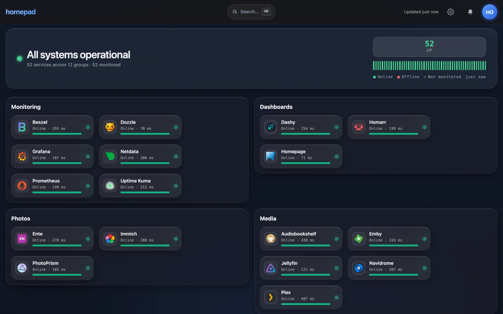
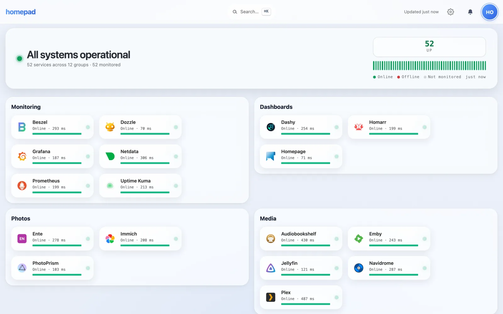
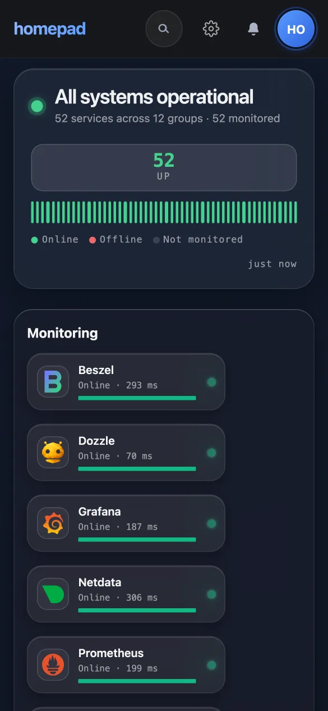
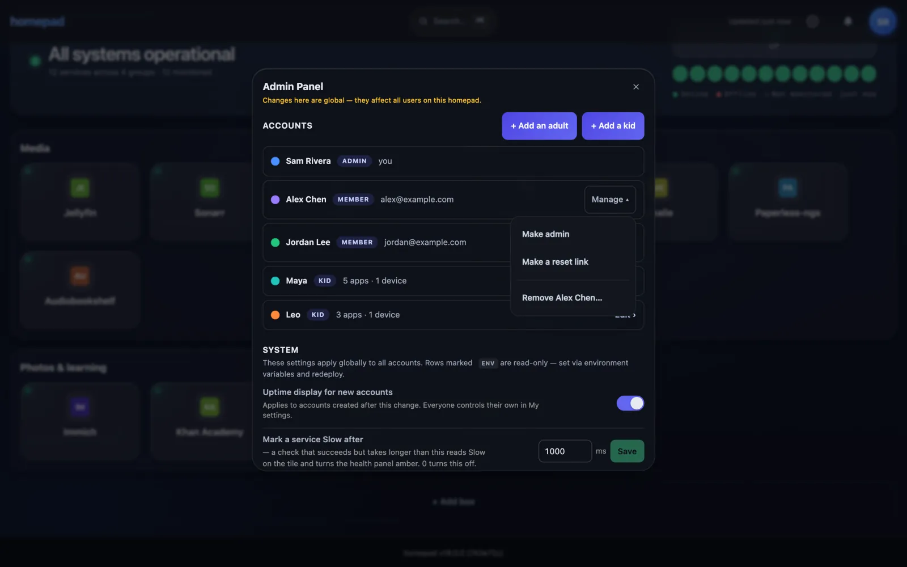
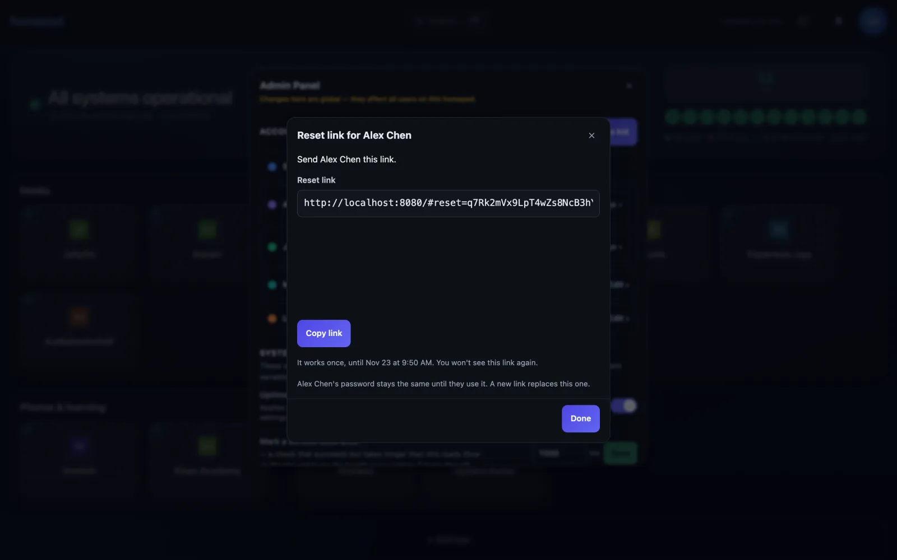
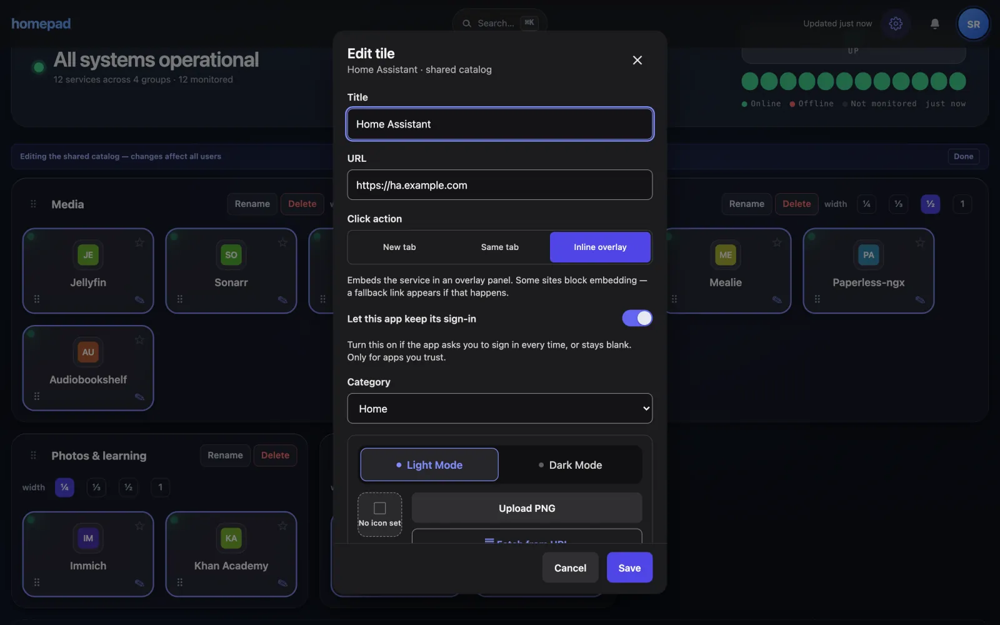
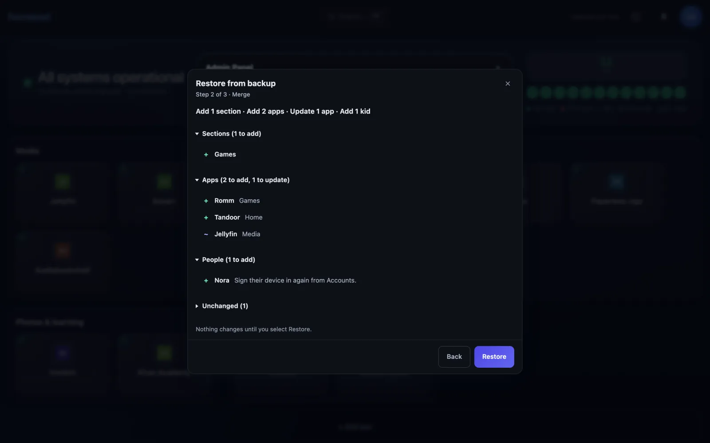

<p align="center">
  
</p>

<p align="center">
  <strong>The self-hosted homelab dashboard for the whole household.</strong><br>
  Every service in one place, with live health, and a personal view for everyone under your roof.
</p>

<p align="center">
  <a href="https://gethomepad.dev">Website</a> ·
  <a href="https://demo.gethomepad.dev">Live demo</a> ·
  <a href="#quickstart">Quickstart</a> ·
  <a href="#how-it-compares">Compare</a> ·
  <a href="./docs/development.md">Develop</a>
</p>

<p align="center">
  <a href="https://github.com/finish06/homepad/tags"></a>
  <a href="https://github.com/finish06/homepad/pkgs/container/homepad"></a>
  <a href="./LICENSE"></a>
  <a href="https://github.com/finish06/homepad/stargazers"></a>
</p>

<p align="center">
  
</p>

## Try it in 10 seconds

**[demo.gethomepad.dev](https://demo.gethomepad.dev)**, log in with `homepad@gethomepad.dev` / `homepad1`. There's no signup. The demo may take about 15 seconds to wake up.

## Quickstart

You need Docker with Compose v2.23 or newer. Nothing else to clone or build:

```bash
mkdir homepad && cd homepad
curl -fsSLO https://raw.githubusercontent.com/finish06/homepad/main/compose.yaml
echo "POSTGRES_PASSWORD=$(openssl rand -hex 16)" > .env
echo "HOMEPAD_SECRET_KEY=$(openssl rand -hex 32)" >> .env
docker compose up -d
```

Open **http://localhost:8080**. It shows **Set up Homepad**: **the first account is the admin.** Sign-up is closed after that, so nobody else can make an account on their own. Finish setup before you expose Homepad outside your LAN.

Next steps:
- **Add your apps.** Pick from the built-in App Library of 50+ self-hosted apps with icons, or add your own.
- **Live status.** Connect [Gatus](https://gatus.io): add `COMPOSE_PROFILES=gatus` and `GATUS_BASE_URL=http://gatus:8080` to `.env` to run one alongside. See [docs/monitoring.md](./docs/monitoring.md).
- **Add adults.** In Administration → Accounts, **+ Add an adult** makes an invite link. See [Registration](#registration) and [docs/accounts.md](./docs/accounts.md).
- **Kids.** Give a kid a dashboard with only the apps you choose, signed in on the family iPad for months. See [docs/kid-accounts.md](./docs/kid-accounts.md).
- **Widgets.** A few numbers on your Jellyfin, Sonarr and Radarr tiles, plus a clock, the weather and web search. Add `HOMEPAD_SECRET_KEY` to `.env` to store API keys. See [docs/widgets.md](./docs/widgets.md).
- **Back up, or import from Homepage.** Download your whole dashboard as one file, restore it, or bring in your Homepage `services.yaml`. See [docs/backup-import.md](./docs/backup-import.md).
- **Single sign-on.** See [SSO](#single-sign-on) below.
- **Update** with `docker compose pull && docker compose up -d`.

Images: `ghcr.io/finish06/homepad` and `ghcr.io/finish06/homepad-api`, for linux/amd64 and linux/arm64 (so a Raspberry Pi works). They're pinned by `HOMEPAD_VERSION` in `.env`.

## Why Homepad

Homepad is a dashboard for a household. The admin keeps one list of apps. Everyone in the house signs in and gets their own view of it.

- **Sign in, built in.** Local accounts, or OIDC with PKCE from a provider such as PocketID. People in your admin group become admins, and people in your member group become members. Sign-in has a speed limit. See [Single sign-on](#single-sign-on).
- **Edit in the browser.** The admin adds and edits apps, sections and icons in the browser. Pick from the App Library or add your own. Each tile opens in a new tab, the same tab, or an overlay. Apps in the overlay are locked down by default. To let a trusted app keep its sign-in there, turn on **Let this app keep its sign-in** in its settings.
- **A view for each person.** Each person keeps their own favorites, tile order, theme and tile size.
- **Light, dark or system.** Each person picks Light, Dark or System. System follows the device as it changes. The theme is set before the page draws, so it does not flash on load.
- **Live status, checked on the server.** Each tile can show UP, DEGRADED or DOWN, its response time and recent uptime, from [Gatus](https://gatus.io). The API asks Gatus. The browser gets only each tile's result, never the addresses Gatus checks. Admins can see the Gatus address in Settings.
- **Manage the household.** Admins add adults with an invite link, make them an admin or a member, or remove them. Homepad always keeps at least one admin. Every admin edits the same app list. See [docs/accounts.md](./docs/accounts.md).
- **Passwords.** An admin can make a one-time reset link for an adult who forgot their password. It works for 24 hours. Everyone can change their own password in **My settings**. Homepad sends no email.
- **Kid accounts.** A kid account is a name and a color, with only the apps you pick. See [docs/kid-accounts.md](./docs/kid-accounts.md).
- **Installs like an app.** Add it to the home screen of a phone or iPad. Touch-sized targets.
- **Fast to get around.** ⌘K search across every app, apps grouped into sections, and Large, Compact or List tiles.
- **Widgets.** Jellyfin, Sonarr and Radarr tiles can show up to three numbers each, such as what's playing or what's missing. A strip at the top can show a clock and the weather, and ⌘K can search the web. The app keys need `HOMEPAD_SECRET_KEY` on the API. The clock, weather and web search work without it. See [docs/widgets.md](./docs/widgets.md).
- **Backup and import.** Admins can download the whole dashboard as one file, restore it, or import a Homepage config. See [docs/backup-import.md](./docs/backup-import.md).

<p align="center">
  
  &nbsp;
  
</p>

The admin's view, in order: an adult's **Manage** menu in Accounts, a reset link, the overlay sign-in switch, and a restore preview.

<p align="center">
  
  
</p>
<p align="center">
  
  
</p>

## How it compares

Each cell was checked on 2026-11-07 against the project's own docs and code: Homepage 2.7, Homarr 2.12, Dashy 4.9 and Heimdall 2.8. If something here is wrong or out of date, please open an issue.

|  | Homepad | Homepage | Homarr | Dashy | Heimdall |
|---|:-:|:-:|:-:|:-:|:-:|
| Each person signs in to their own dashboard | ✓ | ✕ ¹ | ✓ | ⚠ ² | ✓ |
| Add and edit apps in the browser | ✓ | ✕ | ✓ | ✓ | ✓ |
| Built-in OIDC sign-in | ✓ | ✓ ¹ | ✓ | ✓ | ✕ ⁴ |
| Live status, checked on the server | ✓ | ✓ | ✓ | ✓ | ✕ ⁴ |
| The address being checked stays off the browser | ✓ | ✕ ³ | ✕ ³ | ✕ ³ | ✕ |
| Installs to the home screen (PWA) | ✓ | ✓ | ✓ | ✓ | ✕ |

✓ yes · ⚠ partly, see the note · ✕ no

1. Homepage has an optional login since 2.0: one shared password, or OIDC. Everyone who signs in sees the same page. Apps are set in YAML files.
2. Dashy lists users in its config file. The admin can hide sections or items for some users. Everyone else sees the same dashboard.
3. Homepage, Homarr and Dashy run status checks on the server. The address each check uses is also sent to the page. Homepad sends the page only the result.
4. Heimdall has local users and can trust a sign-in header from a proxy. It has no up or down status checks.

Homepage has more than 100 service widgets and can run next to Homepad. Homepad has widgets for Jellyfin, Sonarr and Radarr, plus a clock, the weather and web search.

## Registration

Sign-up is closed by default (`HOMEPAD_REGISTRATION=invite_only`). The first account on a fresh install is the admin. After that:

- **Adults** join through an invite link. In **Administration → Accounts**, tap **+ Add an adult**, enter a name, pick **Member** or **Admin**, and send them the link. It works once, for 7 days, and they pick their own email and password. You can revoke a link that hasn't been used. Each adult's row has a **Manage** menu to change their role, make a reset link, or remove them. See [docs/accounts.md](./docs/accounts.md).
- **Kids** are added in the same place. See [docs/kid-accounts.md](./docs/kid-accounts.md).
- **Single sign-on** makes accounts for people in your admin or member group (`OIDC_ADMIN_GROUP`, `OIDC_MEMBER_GROUP`). Anyone else needs an invite. Their provider must mark their email as verified. See [Single sign-on](#single-sign-on).

`HOMEPAD_REGISTRATION=open` lets anyone who can open Homepad make an account. Accounts shows a warning while it's on, because a kid who signs out could make an adult account. To close it, set `HOMEPAD_REGISTRATION=invite_only` in `.env` and run `docker compose up -d`. Check the current mode in **Admin Panel → System → Registration mode**.

`HOMEPAD_MAX_ACCOUNTS` caps the number of accounts plus pending invites. Unset or `0` means no limit.

## Single sign-on

Local accounts work out of the box. To add OIDC, set in `.env`:

```dotenv
OIDC_ENABLED=true
OIDC_ISSUER=https://auth.example.com
OIDC_CLIENT_ID=homepad
OIDC_CLIENT_SECRET=...
OIDC_REDIRECT_URL=https://homepad.example.com/api/auth/oidc/callback
OIDC_ADMIN_GROUP=homepad-admins   # people in this group become admins
OIDC_MEMBER_GROUP=homepad         # people in this group become members
```

Register the redirect URL with your provider, then run `docker compose up -d`. With `OIDC_ENABLED=false`, the SSO endpoints aren't registered and the login screen shows local sign-in only.

**Single sign-on needs verified emails.** Homepad signs you in with single sign-on only when your identity provider says your email is verified. Without that, anyone who could change their email at the provider could sign in as someone else here.

**PocketID 2.2 and newer**

1. For people who already have a PocketID account: open **Settings → Users** and open each person. Next to **Email**, turn on the toggle ("Mark as verified"). Save.
2. For people you add later: open **Settings → Application Configuration → Email** and turn on **Emails verified by default**. This does not change people who already exist.
3. Or set **Email Verification** to **Optional** or **Required**, and set up email in PocketID. Then people verify their own address.

If you run PocketID with `UI_CONFIG_DISABLED=true`, set `EMAILS_VERIFIED=true` in its environment instead of step 2.

**PocketID 2.1 and older:** turn on **Emails Verified** in Application Configuration. This marks every user's email as verified.

**Other providers:** make sure the ID token or the userinfo answer has `"email_verified": true`. Homepad asks for the `openid profile email groups` scopes.

**Who gets an account.** With `HOMEPAD_REGISTRATION=invite_only` (the default), single sign-on creates an account only for people in `OIDC_ADMIN_GROUP` (they become admins) or `OIDC_MEMBER_GROUP` (they become members). Anyone else needs an invite first. After they accept it, they can sign in with single sign-on if their email matches.

**Sign-in limits.** Homepad limits how fast sign-in can be tried. If another proxy sits in front of Homepad, set `HOMEPAD_TRUSTED_PROXIES` to its address so Homepad can tell people apart. Without it, everyone shares one limit. In the quickstart, list Homepad's own `web` container too: `HOMEPAD_TRUSTED_PROXIES=web`, or `web,<your proxy's address>`.

The full guide, with how to make the groups in PocketID, is [docs/single-sign-on.md](./docs/single-sign-on.md). On plain `http://`, single sign-on also needs `COOKIE_SECURE=false`. See [Running it for real](#running-it-for-real).

## Running it for real

- **HTTPS.** Put Homepad behind your reverse proxy (Traefik, Caddy, nginx, Pangolin…) and set `COOKIE_SECURE=true`. Use `false` only for plain `http://`. There, password sign-in and single sign-on both need it, or the browser drops the sign-in cookie.
- **Port.** Set `HOMEPAD_WEB_PORT` (default 8080).
- **Data.** Everything lives in the `homepad_pg` Postgres volume; the web and API containers are disposable. Back that volume up. Admins can also download a backup in the Admin Panel, under **Backup and import**.
- **Widget keys.** Keep a copy of `HOMEPAD_SECRET_KEY` with your backups. If it is lost or changed, saved widget keys have to be entered again.
- **Behind a proxy.** Set `HOMEPAD_TRUSTED_PROXIES` so the sign-in speed limit can tell people apart. In the quickstart, that's `web`, plus your proxy if you have one. See [Single sign-on](#single-sign-on).
- **Locked out.** If you are the only admin and forget your password, run `docker compose exec api /homepad-api reset-link you@example.com` on the server. See [docs/accounts.md](./docs/accounts.md#forgotten-passwords).
- **Framing.** Homepad can't be shown inside another page or dashboard.
- **All settings** are documented in [`.env.example`](./.env.example).

## Project

- **Docs:** [monitoring](./docs/monitoring.md) · [single sign-on](./docs/single-sign-on.md) · [accounts](./docs/accounts.md) · [kid accounts](./docs/kid-accounts.md) · [widgets](./docs/widgets.md) · [backup and import](./docs/backup-import.md) · [development](./docs/development.md) · [changelog](./CHANGELOG.md)
- **Backend:** [finish06/homepad-api](https://github.com/finish06/homepad-api) (Go + Postgres)
- **Contributing:** issues and PRs are welcome. Start with [docs/development.md](./docs/development.md).
- **License:** [MIT](./LICENSE)

If Homepad is useful to your household, a ⭐ helps other homelabbers find it.
