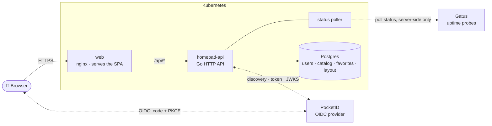

# Developing Homepad

Everything a contributor needs. To just **run** Homepad, see the
[quickstart in the README](../README.md#quickstart).

Homepad is two repos: this one (the React + Vite web app) and
[`homepad-api`](https://github.com/finish06/homepad-api) (the Go backend).
Specs live in [`specs/`](../specs/), starting with
[`specs/v1-launcher.md`](../specs/v1-launcher.md); the index is
[`specs/README.md`](../specs/README.md).

## Architecture



The browser only ever talks to `web` (the SPA) and, same-domain, to `/api/*`.
Gatus is reachable **only** from the backend poller — never from a browser
session (spec AC A11).

## Authentication

Both login paths land on the **same** `homepad_session` cookie, so the rest of
the app is identical regardless of how you signed in.

```mermaid
sequenceDiagram
  autonumber
  participant B as Browser
  participant A as homepad-api
  participant P as PocketID (OIDC)
  participant DB as Postgres

  rect rgb(15,23,42)
  note over B,DB: Local — email / password
  B->>A: POST /api/login (email, password)
  A->>DB: look up user, verify bcrypt hash
  A-->>B: Set-Cookie homepad_session → 200
  end

  rect rgb(2,6,23)
  note over B,P: PocketID — Authorization Code + PKCE
  B->>A: GET /api/auth/oidc/login
  A-->>B: 302 → PocketID authorize<br/>(state, nonce, PKCE S256 challenge)
  B->>P: authorize + consent
  P-->>B: 302 → /api/auth/oidc/callback?code&state
  B->>A: GET /api/auth/oidc/callback?code&state
  A->>P: exchange code + PKCE verifier → tokens
  P-->>A: id_token (+ JWKS for verify)
  A->>A: verify RS256 sig · iss / aud / exp / nonce
  A->>DB: link-by-email or provision user<br/>(admin iff in OIDC_ADMIN_GROUP)
  A-->>B: Set-Cookie homepad_session → 302 /
  end
```



`GET /api/auth/config` returns `{"oidcEnabled":bool}` so the web app knows
whether to render the PocketID button. When OIDC is disabled the two `/oidc/*`
endpoints are unregistered (404) and homepad is local-only.

## Layout

```
src/                React app (App, Catalog, api client) + Vitest specs
tests/e2e/          Playwright specs, one per acceptance criterion
specs/              Source-of-truth spec + test plan (lives in this repo)
docs/               Docs and README assets (banner, screenshots)
lighthouserc.cjs    Lighthouse CI thresholds (AC A8)
```

## Run locally

```bash
npm install
npm run dev          # vite dev server on :5173, proxies /api → :8080
```

For the full app to do anything useful, also run `Code/homepad-api` locally
(`make run`).

## Building the whole stack from source

The fastest way to run the whole stack — frontend, Go API, Postgres, and a
Gatus status source — on your own machine. One command, no Kubernetes.

**Prerequisites:** Docker Engine 24+ with the Compose plugin (`docker compose
version`).

```bash
git clone https://github.com/finish06/homepad.git
cd homepad
cp .env.example .env          # then edit POSTGRES_PASSWORD (at minimum)
docker compose -f compose.build.yaml up --build -d
```

Then open **http://localhost:8080**. The **first account you register becomes
the admin** — create it, then set `HOMEPAD_REGISTRATION=invite_only` in `.env`
and `docker compose up -d` again to lock down sign-ups.

Check status and logs:

```bash
docker compose ps            # `web` shows healthy once the full chain is up
docker compose logs -f api   # look for "migrations applied"
```

What each service does:

| Service    | Image / build                    | Purpose                                            |
| ---------- | -------------------------------- | -------------------------------------------------- |
| `web`      | built from this repo's Dockerfile | nginx serving the built SPA; proxies `/api` → api |
| `api`      | built from `homepad-api`          | Go backend; runs DB migrations on boot            |
| `postgres` | `postgres:16-alpine`              | all persistent data (accounts, dashboards, icons) |
| `gatus`    | `ghcr.io/twin/gatus`              | uptime source the dashboard status tiles read from |

All configuration lives in `.env` (see `.env.example` for the full list with
defaults). Notes:

- **Persistence.** Everything is stored in Postgres, kept in the named volume
  `homepad_pg`. That's the only stateful volume — the web and api containers are
  disposable. Back up (or `docker compose down -v` to wipe) that volume.
- **The API build source.** The Go backend is a separate repo.
  `compose.build.yaml` builds it from `HOMEPAD_API_CONTEXT` (default: the public
  GitHub repo); the quickstart `compose.yaml` pulls the published image instead. To build from a
  local checkout, clone both repos side by side and set
  `HOMEPAD_API_CONTEXT=../homepad-api`.
- **HTTPS.** Over plain-HTTP localhost, `COOKIE_SECURE=false` (the default in
  `.env.example`) is required or the login cookie is dropped. Set it `true` only
  when you serve Homepad behind a TLS-terminating proxy.
- **Status tiles.** Gatus is optional. In the quickstart, enable it with
  `COMPOSE_PROFILES=gatus`; `compose.build.yaml` always runs it from
  `deploy/compose/gatus.yaml`. Both ship two example checks: replace them with
  your own services.

## Test

```bash
npm test                       # Vitest component/unit suite
npm run test:e2e:install       # one-time Playwright browsers
npm run test:e2e               # full E2E suite (desktop + mobile)
npm run build && npm run lhci   # Lighthouse perf budgets (AC A8)
```

## Deploy

The production Kubernetes manifests live in a separate platform repo, not here.
This repo ships:

- `Dockerfile`: multi-stage Vite build, served by nginx.
- `nginx.conf`: SPA fallback and caching headers. Routing `/api/*` to
  `homepad-api` is the ingress's job (or, in Docker Compose, the web
  container's: see `compose.yaml`).
- Public images: every merge to `main` publishes
  `ghcr.io/finish06/homepad:<sha>` and `:latest`, and every `vX.Y.Z` tag
  publishes `:X.Y.Z`, `:X.Y` and `:X`, for linux/amd64 and linux/arm64
  (`.github/workflows/ghcr-release.yml`; see `docs/cicd.md`).
- The deployment contract: see [`specs/v1-launcher.md`](../specs/v1-launcher.md).
